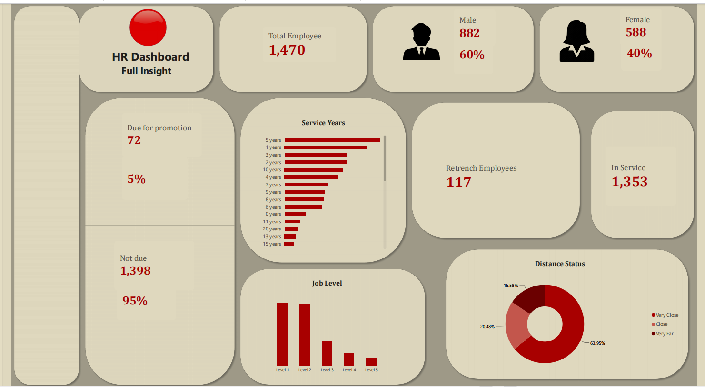
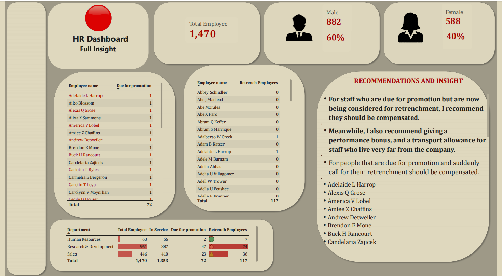

# HR Analytics Dashboard (Power BI)

> **Note:** This project uses a class dataset (1,470 employees). It is not real company data.

**Project:** A two-page Power BI HR dashboard built as an assignment for the BoyCode Africa Data Analysis Program, Cohort 5.0.

## Dashboard

## Business Problem
The HR team needs one dashboard that answers these questions: total employees, total male and female (with percentages), staff due and not due for promotion (with percentages), service years, job levels, staff next to retrench, active workers, and distance from home.

## Dataset
- 1,470 employees and 35 columns (age, department, job level, years at company, years since last promotion, distance from home and others).
- A second file holds employee names for the same 1,470 employee numbers.
- The data is a class dataset, not real company data.

## Data Preparation (Power Query)
- The source Excel file stores each record as one tab-separated text line, so the column was split by delimiter, headers were promoted and data types were set.
- Duplicates were removed (no duplicate rows were found in the file).
- New columns were added with conditional and custom steps, including Retrenchment Status ("Be Retrench" if years at company is 18 or more, otherwise "On service"), Service Year and Distance Status.
- The names table was added to the data model so names appear on the Details Analysis page.
- The rules were given by the tutor: due for promotion = 10 or more years since last promotion; next to retrench = 18 or more years at the company; distance groups: Very Close (1-9), Close (10-19), Very Far (20-29).

## Analysis
- DAX measures (in a measures table called "All Measure") drive the cards, charts and tables.
- Page 1: cards, a Service Years bar chart, a Job Level column chart and a Distance Status donut chart.
- Details Analysis page: lists of staff due for promotion and next to retrench by name, a department table with conditional formatting, and a recommendations box.

## Key Findings
1. The company has 1,470 employees: 882 male (60%) and 588 female (40%).
2. 72 employees (5%) are due for promotion and 1,398 (95%) are not.
3. 117 employees are next to retrench (18+ years at the company) and 1,353 are in service. By department: Research & Development 74, Sales 36, Human Resources 7.
4. Most employees live very close to work: Very Close 63.95%, Close 20.48%, Very Far 15.58%.
5. 5 years of service is the most common length of service, and Job Levels 1 and 2 have the most employees.

## Recommendations (author's view, not proven by the data)
- Staff who are both due for promotion and next to retrench should be compensated.
- Consider a performance bonus.
- Consider a transport allowance for staff who live very far from the company.

## Limitations
- This is a class dataset, so the results cannot be applied to a real company.
- "Next to retrench" only means 18 or more years of service. The data does not show that anyone is actually being laid off.
- The dashboard shows counts and groups only. It does not explain why any pattern exists.
- The recommendations are the author's opinion and are not tested by the data.

## Files in this Repository
- `Dashboard-1.png` - screenshot of Page 1
- `Dashboard-2.png` - screenshot of the Details Analysis page
- `HR_ANALYTICS_DATA.pbix` - the Power BI report
- `HR_ANALYTICS_DATA.pdf` - PDF copy of the two dashboard pages
- `HR-Analytics-Data.xlsx` - the main employee dataset
- `HR-Employee-Data.xlsx` - employee names

## Tools
Power BI Desktop: Power Query (split column by delimiter, promote headers, change data types, remove duplicates, conditional and custom columns), DAX measures, data modelling with two data tables, conditional formatting (data bars and icons), cards, tables, bar, column and donut charts. Microsoft Excel (source files).

## Author
Israel Abidoye | BoyCode Africa Data Analysis Program, Cohort 5.0

[GitHub profile](https://github.com/Israel-Abidoye)
